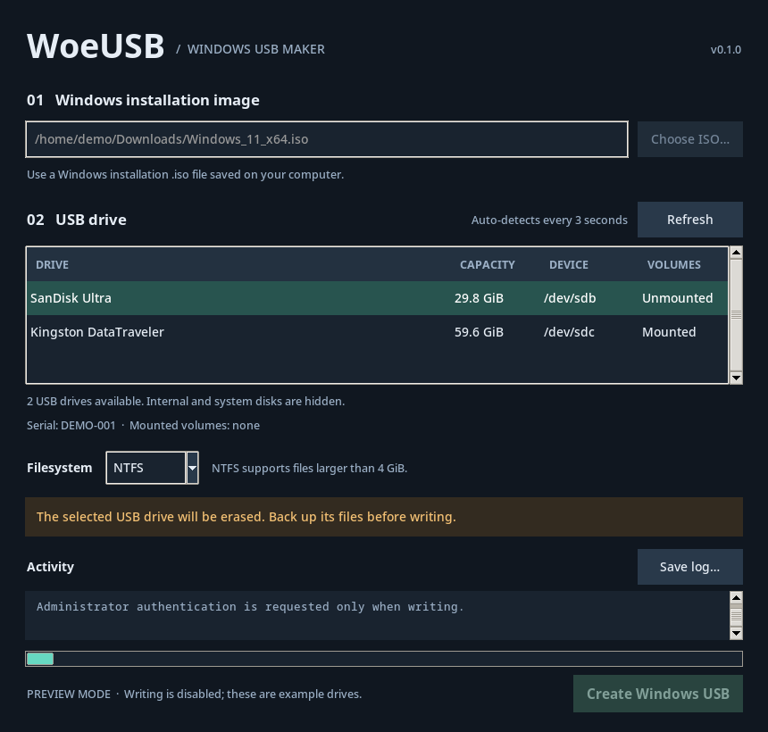

# WoeUSB GUI

A small Linux desktop app for making a Windows installer USB with an existing
[WoeUSB](https://github.com/WoeUSB/WoeUSB) installation. Pick an ISO, select a USB
drive, and follow the write log. Python + Tk; no third-party Python dependencies.



## Features

- USB drive detection every three seconds, plus manual refresh.
- Drive model, capacity, device path, serial number, and mounted-volume details.
- NTFS or FAT32, with automatic unmounting after confirmation.
- A typed device-name confirmation before erasing a drive.
- Live WoeUSB output, clear completion/error status, and a save-log button.
- Desktop authentication through polkit; the GUI runs as your normal user.
- A harmless `--demo` mode for previewing the interface.

**Creating a USB erases every partition and file on the selected drive.** Back up
anything you want to keep. USB external hard drives may appear alongside thumb
drives, so check the model, capacity, serial, and device path before confirming.

## Requirements

- Linux, Python 3.10+, and Tk 8.6+.
- A system-wide `woeusb` executable and its dependencies. Developed against
  **WoeUSB 5.2.4**. The separately maintained WoeUSB-ng also uses the `woeusb`
  command, but has not been tested with this wrapper.
- `lsblk` and `umount` from util-linux, plus `pkexec` from polkit.
- A graphical desktop with a running polkit authentication agent.
- A Windows installation ISO and a USB drive with enough room for its contents.

On Arch / CachyOS, install the desktop dependencies:

```sh
sudo pacman -S --needed python tk util-linux polkit
```

Install WoeUSB separately using your distribution's package or the
[upstream installation instructions](https://github.com/WoeUSB/WoeUSB#installation).
The executable and its parent directories must be root-owned and not writable
by other users. User-local `~/.local/bin/woeusb` installs are intentionally unsupported.

On Debian / Ubuntu, the desktop dependencies are `python3`, `python3-tk`,
`util-linux`, and `pkexec`. WoeUSB's dependencies are additional; see upstream.
On a minimal window manager, also install/start your desktop's polkit agent.

## Run

From the project directory:

```sh
./run.sh
```

Or use `python3 -m woeusb_gui`. Do not start the GUI with `sudo`.

1. Choose the Windows ISO, stored on your computer rather than the target USB.
2. Plug in the USB and explicitly select its row. No drive is auto-selected.
3. Choose NTFS or FAT32. The default is NTFS. Firmware support and large-file
   handling depend on your installed WoeUSB; see its documentation.
4. Click **Create Windows USB**, check the details, and type the device name
   shown in the confirmation dialog (for example, `sdb`).
5. Authenticate in the desktop password dialog. It may identify the helper as
   **Python**. Only this per-write helper runs as administrator.
6. Keep the window open and the drive connected until completion. Eject the
   drive using your desktop before unplugging it.

Mounted USB volumes are unmounted without force after confirmation. If a volume
is busy, close files/file-manager windows using it and retry. A write in progress
cannot be cancelled from this UI; WoeUSB is allowed to finish and clean up.
The progress bar indicates activity, not a fabricated completion percentage.

Optional application-menu shortcut (no root required):

```sh
python3 scripts/install_desktop.py
```

The shortcut points at this checkout. Re-run the command if you move the folder.
Remove `~/.local/share/applications/woeusb-gui.desktop` to uninstall the shortcut
(or the equivalent under `XDG_DATA_HOME` if you use that override).

Preview the interface without access to real drives:

```sh
./run.sh --demo
```

## Device checks and limitations

Only whole, writable disks reported as USB by `lsblk` are candidates. Internal
disks, active LVM/RAID/encrypted mappings, swap, and disks with system mounts are
excluded. Mounted volumes must live below `/media/`, `/run/media/`, or `/mnt/`;
a disk mounted elsewhere is hidden until you unmount it yourself. Card readers
without USB transport are outside this app's scope.

Before writing, and again **after authentication**, the helper checks device
path, capacity, model, serial/WWN, device number, and Linux disk sequence number
(where available). It also checks that the ISO is unchanged, readable, larger
than zero bytes, smaller than the drive, and not stored on the target's reported
partitions or mount paths. These checks do not verify that an ISO is genuine or
bootable. WoeUSB validates and prepares the installation media.

Do not disconnect/reconnect drives during a write. Device checks cannot make
hot-unplugging during formatting safe. Complex storage arrangements, unusual
bind mounts, network ISOs, and older kernels with missing device identity fields
are not a supported validation target.

WoeUSB may need Internet access for its NTFS UEFI bootloader download. Successful
creation does not guarantee a particular machine's firmware/Secure Boot setup
will boot the drive. Test on the intended machine before relying on it.

## Troubleshooting

- **No USB drive appears:** click Refresh, check `lsblk`, and review the exclusion
  rules above. The app deliberately hides system disks and disks without usable
  identity information.
- **Authentication unavailable:** ensure a desktop polkit agent is running.
  The app does not collect passwords or fall back to an invisible terminal prompt.
- **WoeUSB fails:** inspect/save the Activity log. Missing WoeUSB dependencies,
  insufficient space, a busy volume, and bootloader-download errors are reported
  by the backend. Logs can contain local filenames and drive details; review
  them before posting an issue.
- **No display / Tk missing:** run inside a graphical session and install the Tk
  package for your distribution's Python.

## Development and verification

```sh
python3 -m unittest discover -v
# Include real Tk interaction tests on a virtual display:
xvfb-run -a python3 -m unittest discover -v
```

Tests simulate block-device inventories, removal/replacement, source-file
validation, unmount failures, authentication cancellation, and GUI interaction.
A harmless Python subprocess verifies terminal output and WoeUSB's known
error-display prompts. **Tests never invoke a real write or unmount a disk.**

GitHub Actions runs the tests on Ubuntu 22.04 and 24.04 in a required-check-ready
job named `test`, including headless Tk interaction. It also builds the package.

Initial local verification: CachyOS, Python 3.14, Tk 8.6, WoeUSB 5.2.4 installed.
**A physical USB write and boot test have not yet been performed.** Use a spare
drive for the first trial before publishing a release.

### Architecture

`app.py` owns the Tk interface; `devices.py` reads `lsblk` JSON and validates
requests; `runner.py` starts `pkexec` off the UI thread; `helper.py` repeats checks,
unmounts the selected volumes, and invokes the independently installed WoeUSB.
The helper gives WoeUSB a pseudo-terminal and forwards output to the GUI.
Paths are passed as argument lists, never interpolated into shell commands.
No custom polkit policy, daemon, or password storage is installed.

Environment/configuration: no `.env`, credentials, API keys, or application
settings are required. Standard desktop display/session variables are inherited.
Only the shortcut installer uses optional `XDG_DATA_HOME`. The write helper uses
a fixed system executable search path and an isolated Python interpreter.

Deployment: this is a local desktop tool; distribute a source checkout or build
a wheel with `python3 -m build`. There is no hosted service.

Expected and peak operating cost: **$0/month** in hosting, LLM, and third-party
API charges. Local hardware, electricity, and Internet access are supplied by
the user. No telemetry or cloud API is used by this GUI.

Owner: the repository maintainer. Contributions are welcome; include a focused
test for device-selection or write-safety changes and use conventional commits.

## GitHub preparation

The project can be kept local until a physical drive test passes. Once you create
a GitHub repository, push this directory there and enable branch protection with
the `test` status check. No GitHub remote or publication is needed to run the app.

## License and attribution

MIT for this independent GUI wrapper; see [LICENSE](LICENSE). WoeUSB is a
separate program with its own GPL license and is not bundled here. This project
is not an official WoeUSB release or affiliated with Microsoft.
